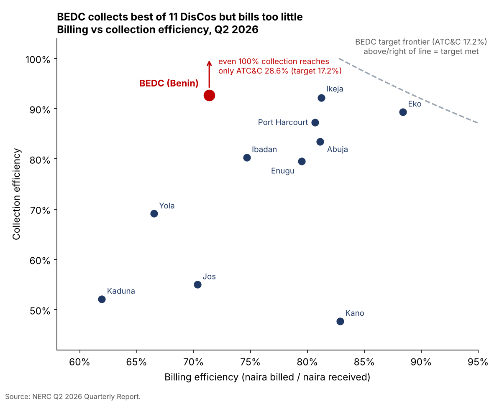
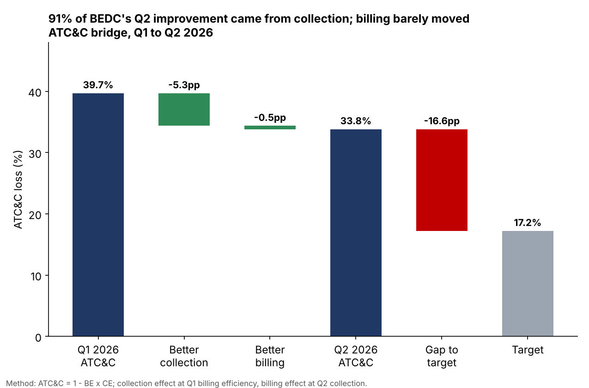
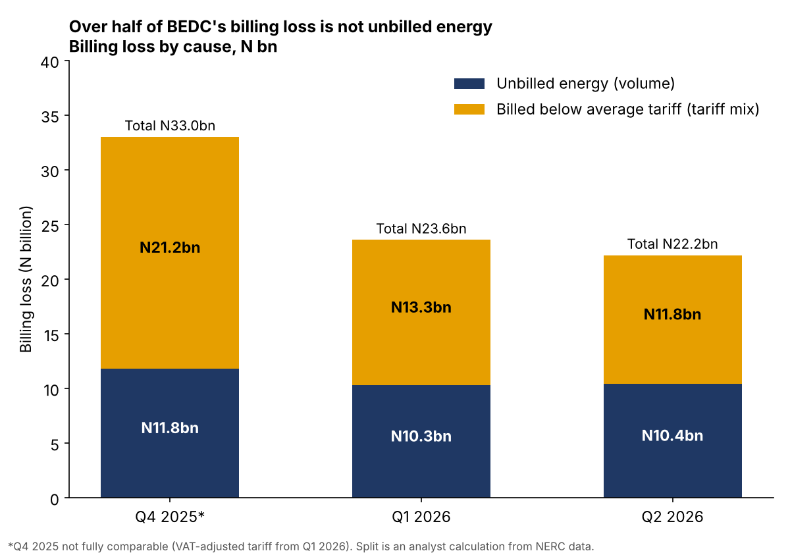
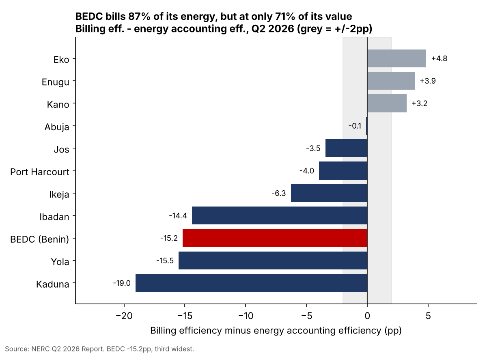

# Why BEDC Misses Its Loss Target: A Revenue Assurance Analysis

**Role targeted:** Data Analyst, BEDC Electricity PLC (Edo State)
**Data:** NERC Quarterly Reports, Q1 2026 and Q2 2026 (public). BEDC appears as "Benin".
**Tools:** Excel (formulas, structured data model), SQL (SQLite), Python (pandas, matplotlib)

---

## Executive summary

BEDC collects more of what it bills than any other distribution company in Nigeria (92.7% in Q2 2026), yet its ATC&C loss is still 33.8% against a regulatory target of 17.2%. The reason is billing, not collection.

1. **Collection is nearly maxed out.** Even at a perfect 100% collection, BEDC's ATC&C loss would be 28.6%, still above target. To hit 17.2% at today's collection rate, billing efficiency must rise from 71.4% to about 89.3%.
2. **Billing is the binding constraint.** BEDC ranks 8th of 11 on billing efficiency. In Q2, 91% of its ATC&C improvement came from collection and only 9% from billing.
3. **Over half of the billing loss is not unbilled energy.** Of ₦22.2bn billing loss in Q2, about ₦10.4bn is energy that was never billed. The other ₦11.8bn (53%) is energy that *was* billed, but at less than the average allowed tariff.
4. **The shortfall against target is large.** At target losses BEDC would have collected about ₦64.1bn in Q2; it collected ₦51.3bn, a gap of **₦12.9bn in one quarter**.

## Business problem

Management wants to reduce energy losses and protect revenue (per the job description: "energy loss reduction and revenue assurance"). Which lever (billing or collection) should get priority, and how large is the opportunity?

**Stakeholder:** Head of Commercial / Revenue Assurance.

## Data and method

| Item | Detail |
|---|---|
| Source | NERC Q1 2026 report (Q4-2025 and Q1-2026 columns) and Q2 2026 report |
| Grain | One row per DisCo per quarter (11 DisCos × 3 quarters = 33 rows) |
| Measures | Energy received/billed (GWh and ₦), revenue collected, reported ATC&C, MYTO target, customers, metered customers |
| Validation | Recomputed ATC&C (1 − billing eff. × collection eff.) matches NERC's reported figure within 0.02pp for all 33 rows |

**Derived metrics (defined by this analysis, not published by NERC):**
- **Tariff realization** = billing efficiency ÷ energy accounting efficiency. BEDC: 82.5%, 9th of 11.
- **Volumetric billing loss** = unbilled energy (GWh) × average allowed tariff.
- **Tariff-mix billing loss** = total billing loss − volumetric loss.
- **ATC&C bridge:** the change in ATC&C split into a collection effect and a billing effect that sum exactly to the total.

## Key findings

| Metric (Q2 2026) | BEDC | Rank of 11 |
|---|---|---|
| Collection efficiency | 92.7% | 1st |
| Billing efficiency | 71.4% | 8th |
| ATC&C loss | 33.8% (target 17.2%) | 5th |
| Tariff realization | 82.5% | 9th |
| BE − EAE gap | −15.2pp | 3rd widest |
| Metering rate | 61.0% | 5th |






### Observed facts, interpretations, and hypotheses

| Observed fact | Reasonable interpretation | Hypothesis to test (needs BEDC internal data) |
|---|---|---|
| BEDC bills 86.5% of its energy by volume but only 71.4% by value. | Billed energy carries a below-average tariff. NERC reads a large negative BE−EAE gap as energy skewed to less commercially viable feeders. | Energy delivered mostly to lower-tariff bands; estimated-bill caps on unmetered customers (39% of customers) limit billing. |
| Collection rose 7.5pp (85.2% → 92.7%) while billed ₦ fell 3.2%. | The jump is partly a denominator and timing effect, not only better collecting. | Arrears recovery or collection concentrated on better-paying feeders. NERC itself notes an inverse link between offtake and collection efficiency. |
| Energy offtake fell 5.0% and offtake performance fell from 98.6% to 95.5%. | BEDC is taking less energy than available. | Supply constraints, rainy-season demand, or deliberate feeder rationing. Cost of unused capacity cannot be sized from public data. |

## Business insights and recommendations

Each recommendation is tied to a finding.

1. **Shift focus from collection to billing.** *(Finding: collection ~93%, 100% collection still leaves 28.6% ATC&C.)* Set a billing-efficiency target near 89% as the route to the MYTO target.
2. **Build a feeder × tariff-band × customer-class view and find where billed ₦/kWh falls below the allowed average.** *(Finding: 53% of billing loss is tariff mix.)* This is the single analysis that would confirm or reject the tariff-mix explanation.
3. **Prioritise meter installation on feeders with the largest tariff-mix gap.** *(Finding: 61% metering rate; installations fell 17.5% in Q2, from 72,738 to 59,969.)*
4. **Monitor monthly, not quarterly, to test whether the collection gain is sustainable.** *(Finding: collections rose while billing and offtake fell.)*

### Opportunity sizing (illustrative, not a forecast)

| Share of tariff-mix loss recovered | Extra billing / qtr | Extra cash / qtr | New ATC&C |
|---|---|---|---|
| 25% | ₦2.9bn | ₦2.7bn | 30.3% |
| 50% | ₦5.9bn | ₦5.4bn | 26.8% |
| 100% | ₦11.8bn | ₦10.9bn | 19.8% |

Assumes extra bills are collected at today's 92.7% rate. Even full recovery would not reach the 17.2% target, so volumetric losses (unbilled energy) must also fall.

## Limitations

- Public data is quarterly and DisCo-level; feeder, band, and customer-class data is internal to BEDC.
- Only three quarters are used; they show direction, not a statistical trend. NERC changed the billing-efficiency method in 2025/Q2 and adjusted the tariff for VAT from 2026/Q1, so Q4 2025 → Q1 2026 is context only. The Q1 → Q2 bridge is like-for-like.
- The tariff-mix split is an analyst calculation; its causes are hypotheses.
- Complaints, remittance, and monthly Q2 data were not used in the bridge.

## Possible next steps

- Add Q2/Q3 2025 quarters once methods are reconciled.
- Rebuild the Excel model as a Power BI dashboard (KPI page, bridge page, benchmark page).
- Replace the quarterly view with monthly BEDC data and test the collection-sustainability question.

## Project structure

```
BEDC_Analysis.ipynb                    Python notebook: validation, KPIs, bridge, scenarios, all 4 charts (run end to end)
BEDC_Dashboard.html                    Interactive dashboard (open in any browser, works offline)
BEDC_Revenue_Assurance_Analysis.xlsx   Data, BEDC_Analysis (formulas), Peers_Q2
disco_quarterly.csv                    Tidy dataset (33 rows)
analysis.sql                           KPIs, data check, peer ranking, bridge, shortfall
bedc_kpis.csv                          BEDC KPI table exported by the notebook
charts/                                Four PNG charts (generated by the notebook)
```

**Reproduce:** open `BEDC_Analysis.ipynb` next to `disco_quarterly.csv` and run all cells, or load `disco_quarterly.csv` into any SQL database as `disco_quarterly` and run `analysis.sql`, or open the workbook (all derived cells are live formulas).

## Skills demonstrated

Data validation and cleaning, KPI design, variance (bridge) analysis, peer benchmarking, scenario analysis, SQL (views, window functions, CTEs), advanced Excel (SUMIFS, RANK, structured assumptions), data visualisation, and separating facts from hypotheses.

**Verify before you publish:** re-check a few typed figures against the NERC PDFs, and be ready to explain every formula and the tariff-mix definition in an interview.
